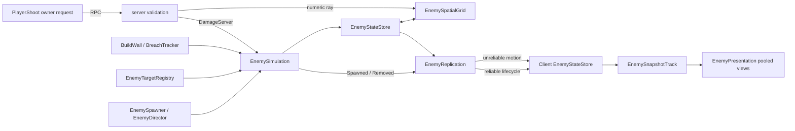
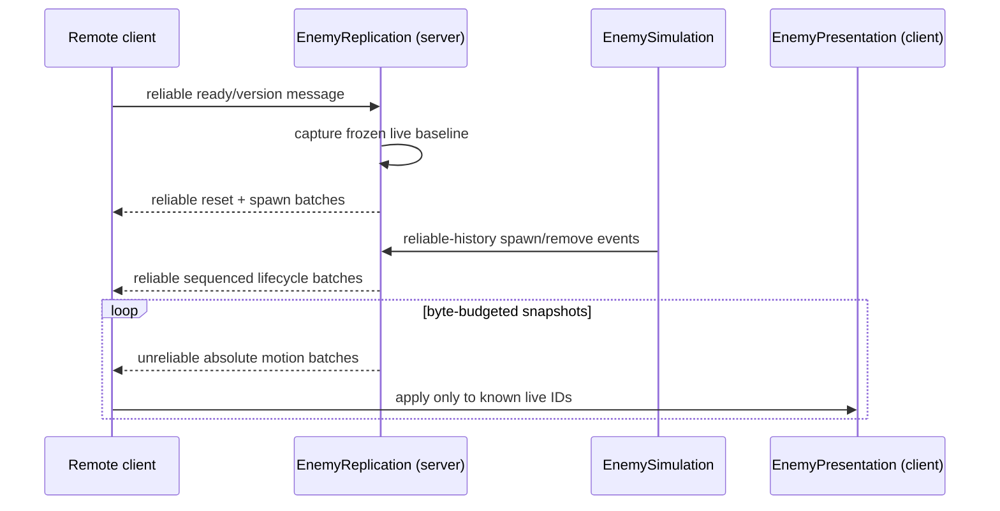
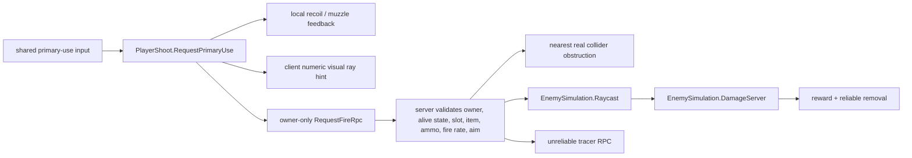

# Architecture

## System boundary

The configured high-count path treats each basic melee enemy as a numeric record, not a Unity gameplay object. One server-side `EnemySimulation` owns authoritative enemy state. Clients own only replicated rosters and visual transforms. The older `EnemyAgent`/`EnemyMotor`/`EnemyHealth`/`NetworkTransform` path remains in the game for legacy compatibility, but it is not the active mass-fodder architecture represented here.

## Spawn, identity, and lifecycle

`EnemyDirector.SpawnEnemy(..., out uint enemyId)` is the common numeric entry point. It rejects a second GameObject-authority path when data simulation is enabled and delegates to `EnemySimulation.SpawnServer`.

`EnemyStateStore` preallocates state, active-slot, free-slot, reverse-index, and grid-mapping arrays to the configured 10,000-slot ceiling. A dictionary maps stable monotonic `uint` IDs to reusable storage slots. Spawn pops a free slot; removal swaps the last active slot into the vacated active-list position. Unity object identity is not used as enemy identity, and an ID is never wrapped onto an earlier life.

On spawn, the simulation initializes target/transient arrays, performs a wide nonalloc ground probe before publishing the first snapshot, phase-offsets the first decision, and emits `Spawned`. On death, `DamageServer` removes the numeric record exactly once, releases formation/breach state, aggregates its reward, and emits `Removed`.

## Scheduling, decisions, and movement

`EnemySimulation.Update` has two clocks:

- Decision credit accumulates from `enemyCount * decisionHz * deltaTime`, capped by `decisionsPerFrame` (default 512). A rotating cursor spreads `Think` calls instead of synchronizing the horde.
- Movement credit advances fixed 30 Hz steps by default, with at most two catch-up steps. Every active numeric record is integrated per movement step.

`Think` performs ground sampling, scores only the registered King and at most four player targets, maintains a small amount of target hysteresis, chooses chase/attack/wall-attack state, assigns a King approach slot, computes soft crowd velocity, and refreshes a cached straight wall corridor only when heading, travel, or geometry requires it. Movement then accelerates velocity toward the already-decided heading and updates the state store/grid.

This is intentionally not a behavior tree or per-enemy `Update`. It reduces Unity callback/object overhead and lets decision frequency differ from smooth movement. It is still an O(N) movement pass and uses scheduled physics probes, so it is not free at arbitrary scale.

## Spatial data and collision proxies

`EnemySpatialGrid` stores XZ cells in a `Dictionary<Vector2Int, Cell>`. Members use array-backed circular doubly linked lists. Moving between cells unlinks/reinserts an integer grid index without allocating a collection.

It exposes two deliberately different queries:

- `QueryNearby` samples a rotating bounded number from the current and eight neighboring cells for steering/contact. This bounds work in extremely dense cells and rotates fairness over time.
- `QueryRadius` exhaustively visits relevant cells and requires capacity-sized caller storage so combat cannot silently truncate victims.

Hitscan uses a 2D DDA traversal in `RaycastCapsules`. Visited grid entries are deduplicated with integer stamps, while `EnemyProxyMath.RayCapsule` performs the exact upright-capsule intersection. Numeric enemies therefore do not need colliders or rigidbodies for weapon hits.

`EnemySteering` supplies deterministic overlap separation, pursuit braking, and bounded velocity composition. `EnemyAttackSlots` precomputes circular or rectangular rings and uses per-ring free lists; attackers can promote into newly freed inner positions without scanning every slot.

## Targets, attacks, walls, and rewards

`EnemyTargetRegistry` holds the strategic King plus a four-entry player list. `EnemyTargetable` registers only live, server-owned King/player objects and forwards damage to the existing `KingHealth` or `PlayerHealth` API. The simulation never searches the scene for targets.

Target scoring keeps the King as fallback, allows nearby players to win, and boosts a recent attacker. At attack time, the server compares numeric distance and uses server-time cooldown timestamps before applying configured damage.

Walls remain real server objects. The simulation caches `BuildWall` blockers from bounded capsule casts. On destruction, `BuildWall` writes a compact opening into the fixed 32-entry `EnemyBreachTracker`. Scheduled decisions can validate an approach/exit route through a nearby opening under one shared per-frame physics-query budget. This is a local two-waypoint response, not general pathfinding.

`EnemyRewardBank` merges drops by 4 m XZ cell and attempts collection every 0.5 seconds through the existing inventory API. It avoids one networked rigidbody pickup per death, but its current invisible, single-item, first-eligible-player behavior is transitional.

## Network authority and replication

NGO remains responsible for the connection, player ownership, RPCs, and ordinary networked objects. `EnemyReplication` adds three explicit remote-peer slots, matching a host plus three remote players.

Lifecycle and motion have different delivery semantics:

Each peer receives a frozen baseline, then lifecycle history. If it falls beyond the fixed history capacity, the server recaptures a baseline instead of pretending it can replay missing history. Motion sends the latest absolute state and never grows an old-motion queue.

`EnemyWireCodec` writes up to 36 records in an approximately 1,100-byte packet. Position is encoded relative to a chunk origin at 2 cm precision when it fits signed shorts, with a full-position escape. Velocity uses 1 cm/s precision, yaw is a `ushort`, health is a `ushort`, and behavior is a byte. Every packet carries a protocol version, epoch, server timestamp, origin, and count. Spawn/removal is reliable sequenced; motion is unreliable.

The default application-level budget is 256,000 bytes/second/client with at most eight packets/client/frame. This is not total UDP usage and does not implement spatial interest management. At high population, it intentionally lowers effective updates per enemy rather than accumulating latency in a queued delta stream.

## Client presentation and interpolation

`EnemyPresentation` owns another numeric roster, fixed snapshot tracks, and a pool of visual-only `Transform` instances. It refuses presentation prefabs containing `NetworkObject`, `Collider`, or `Rigidbody` components. Sixty-four views are prewarmed by default and cold creation is limited to 32 per frame.

`EnemySnapshotTrack` stores eight samples inline—no per-enemy history arrays. Playback uses an adaptive 120–350 ms delay, searches newest-first for a timestamp bracket, prevents render time from moving backward, predicts for at most 300 ms, and decays only prediction/cadence correction. Ordinary interpolated motion is not continuously low-pass filtered. Motion packets cannot create an enemy, so a delayed packet cannot resurrect a removed ID.

The host takes snapshots directly from authority and renders one simulation step behind. Remote clients use buffered server time.

## Weapon-to-enemy flow

The client does not send damage, range, weapon stats, or origin. The reported numeric enemy ID is only a bounded reconciliation hint: the server first performs its own numeric ray, and `ConfirmReportedHit` accepts the hint only if the current authoritative capsule lies within a small tolerance and no nearer real collider blocks it. Projectile and ground-target weapon modes are represented but not implemented in this firing path.

## Architectural tradeoffs

The design gains scale by specializing the basic enemy representation. The tradeoff is that future bosses, flying enemies, projectiles, and complex collision may need different state/archetype lanes rather than forcing every feature into this record. Current direct steering does not solve mazes, cliffs, stacked terrain, or global shortest paths. Visual transforms still scale linearly, and full skinned models/animation could become the dominant client cost. Networking is capped but not relevance-prioritized, so nearby-combat update priority and roster repair are logical future work.

